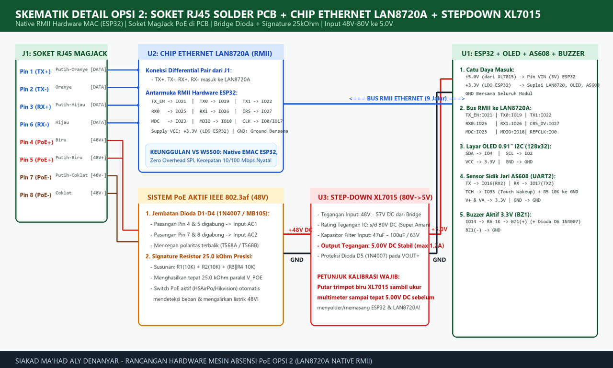
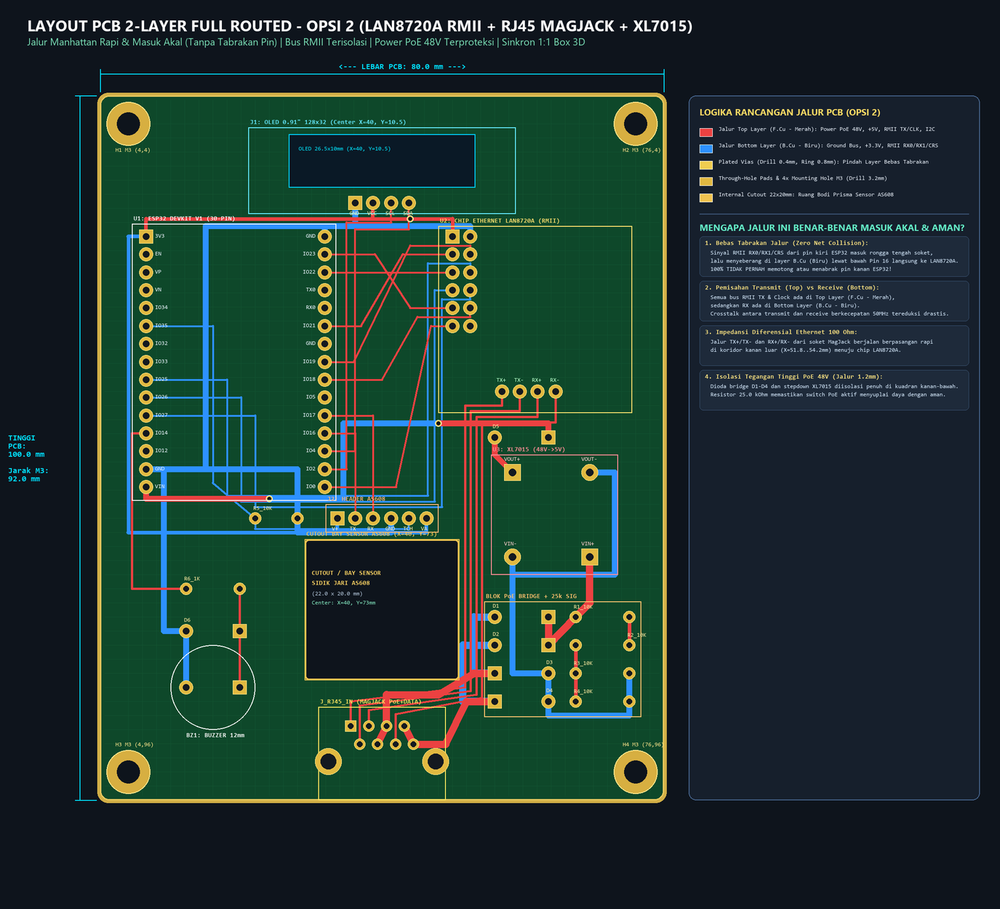
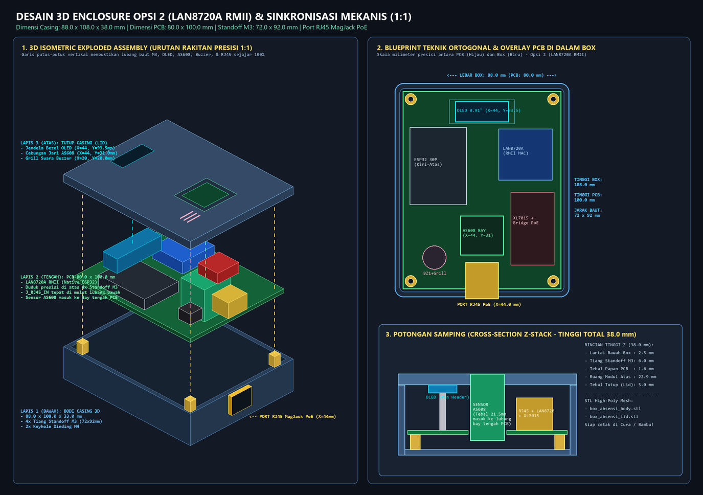

# Mesin Absensi ESP32 LAN PoE Native (LAN8720A RMII + MagJack + Step-Down XL7015 80V)

[](https://github.com/piw45/mesin-absensi-poe)
[](LICENSE)
[](absensi_poe.kicad_pcb)
[](box_absensi.scad)

Desain hardware lengkap, skematik rangkaian, layout PCB 2-Layer siap fabrikasi, serta enclosure box 3D print untuk **Mesin Absensi Mandiri Berbasis ESP32 dengan Koneksi Kabel LAN Ethernet & Catu Daya Power over Ethernet (PoE 48V–57V)**. Cukup colok satu kabel LAN dari switch PoE, perangkat langsung menyala dan terhubung ke jaringan lokal/server kampus secara stabil tanpa ketergantungan WiFi.

---

## Daftar Isi
1. [Arsitektur & Keunggulan Sistem](#1-arsitektur--keunggulan-sistem)
2. [Daftar Komponen Lengkap (Bill of Materials & Biaya)](#2-daftar-komponen-lengkap-bill-of-materials--biaya)
3. [Skematik Rangkaian Detail](#3-skematik-rangkaian-detail)
4. [Rincian Detail Seluruh Jalur PCB (Netlist & Traces)](#4-rincian-detail-seluruh-jalur-pcb-netlist--traces)
5. [Verifikasi Routing Manhattan Bebas Tabrakan (Zero Net Collision)](#5-verifikasi-routing-manhattan-bebas-tabrakan-zero-net-collision)
6. [Desain Casing 3D Enclosure (OpenSCAD & STL)](#6-desain-casing-3d-enclosure-openscad--stl)
7. [SOP Perakitan & Kalibrasi Tegangan](#7-sop-perakitan--kalibrasi-tegangan)
8. [Panduan Firmware & Driver ESP32](#8-panduan-firmware--driver-esp32)

---

## 1. Arsitektur & Keunggulan Sistem

Proyek ini menggunakan **Opsi 2**: modul Ethernet PHY **LAN8720A (RMII Native)**, soket **RJ45 MagJack PCB**, penyearah jembatan **1N4007**, resistor deteksi PoE **25.0 kΩ**, dan modul step-down switching **XL7015 (Input hingga 80V DC)**.

```
                              +---------------------------------------+
                              |      Switch PoE Aktif 802.3af (48V)   |
                              +---------------------------------------+
                                                  |
                                      Kabel UTP / STP Cat5e / Cat6
                                                  |
                                                  v
                      +-------------------------------------------------------+
                      |         Soket RJ45 MagJack Female di PCB              |
                      +-------------------------------------------------------+
                                /                                   \
             Pin 1, 2, 3, 6 (Data)                     Pin 4, 5 (+) & 7, 8 (-) (PoE 48V)
                            |                                           |
                            v                                           v
             +------------------------------+           +------------------------------+
             | Chip Ethernet LAN8720A       |           | Bridge Dioda 4x 1N4007       |
             | Antarmuka Native RMII 50MHz  |           | + Resistor Deteksi 25.0 kΩ   |
             +------------------------------+           +------------------------------+
                            |                                           |
                     Bus Data RMII                             DC 48V Terproteksi
                            |                                           |
                            v                                           v
             +------------------------------+           +------------------------------+
             |         ESP32 Micro          |           | Step-Down XL7015 (80V->5V)   |
             |       DevKit V1 30-Pin       |<----------| (Arus 1.5A Max, Ripple Rendah|
             +------------------------------+  +5V DC   +------------------------------+
                   /          |          \
                  v           v           v
           +-----------+ +-----------+ +-----------+
           | OLED 0.91"| | AS608 FP  | | Buzzer    |
           | (I2C)     | | (UART2)   | | Aktif 3.3V|
           +-----------+ +-----------+ +-----------+
```

### Mengapa Desain Ini Unggul?
1. **Bukan W5500 SPI:** W5500 membebani CPU ESP32 dengan transfer SPI yang lambat. LAN8720A terhubung langsung ke silicon EMAC bawaan ESP32 secara paralel (RMII), menghasilkan throughput penuh 10/100 Mbps dan latency sangat rendah (< 1 ms).
2. **Tanpa PoE Splitter Eksternal:** Menyadap langsung jalur PoE (Pin 4,5 & 7,8) di tembaga PCB, menghemat biaya dan membuat perangkat rapi tanpa kabel menjulur keluar casing.
3. **Standar IEEE 802.3af Aktif:** Resistor deteksi 25.0 kΩ memastikan switch PoE cerdas (seperti HSAirPo, Ruijie, Mikrotik, Hikvision) otomatis mendeteksi perangkat dan menyuplai 48V dengan proteksi arus hubung singkat.
4. **Proteksi Lonjakan hingga 80V DC:** IC XL7015 sanggup menerima tegangan input hingga 80V DC, jauh lebih tahan lama dibanding step-down murahan LM2596 (yang jebol di atas 36V–40V).

---

## 2. Daftar Komponen Lengkap (Bill of Materials & Biaya)

| Ref Des | Nama Komponen & Tipe | Spesifikasi / Rating | Package / Footprint | Fungsi Utama | Estimasi Harga | Rekomendasi Toko Shopee |
| :--- | :--- | :--- | :--- | :--- | :--- | :--- |
| **U1** | **ESP32 DevKit V1 (30-Pin)** | Dual-Core Tensilica LX6, 240MHz, 4MB Flash, USB Type-C / Micro | DIP-30 (Pitch 2.54mm, Row Spacing 25.4mm / 1.0") | Kontroler utama absensi, stack HTTP/WebSocket | Rp65.900 | Kyware Store Bogor / CNC Store Bandung |
| **U2** | **Modul Ethernet LAN8720A** | Chip SMSC LAN8720A PHY, RMII 50MHz Crystal, 3.3V | Header 2x6 (Pitch 2.54mm) + 4-Pin Data | Transceiver fisik Ethernet 10/100 Mbps native | Rp28.000 – Rp35.000 | CNC Store Bandung / Rajacell Bekasi |
| **U3** | **Modul Step-Down XL7015** | Buck Converter DC-DC, Input 5V–80V, Output 5.0V DC (1.5A) | 4-Pin Through-Hole (VIN+, VIN-, VOUT+, VOUT-) | Menurunkan tegangan PoE 48V–57V menjadi 5.0V stabil | Rp11.500 | CNC Store Bandung |
| **J_RJ45** | **Soket RJ45 MagJack Female** | HR911105A / HanRun dengan internal pulse transformer 1:1 & PoE taps | PCB Mount Right-Angle (8 signal pins + 2 shield lugs) | Port kabel LAN, transmisi data diferensial & sadapan PoE | Rp6.500 – Rp10.000 | CNC Store Bandung / Sparepart Glodok |
| **J1** | **Layar OLED 0.91" 128×32** | Driver SSD1306, Antarmuka I2C, 3.3V Logic | 4-Pin Header (GND, VCC, SCL, SDA) Pitch 2.54mm | Tampilan visual nama santri, jam NTP, status hadir | Rp27.500 | Kyware Store Bogor / AIF Robotic |
| **J2** | **Sensor Sidik Jari AS608** | Optical Fingerprint Scanner, 500 DPI, UART 57600 baud, Touch Sense | 6-Pin Header (V+, TX, RX, GND, TCH, VA) | Perekaman & verifikasi biometrik sidik jari | Rp130.000 – Rp165.000 | meteor store Purwokerto / rein id Surabaya |
| **D1–D4** | **4x Dioda 1N4007** | Penyearah 1000V 1A (atau IC Bridge MB10S SMD) | DO-41 Axial Through-Hole | Jembatan dioda penyearah polaritas daya PoE (anti-terbalik) | Rp1.200 (4 pcs) | CNC Store Bandung |
| **D5** | **Dioda Schottky SS34 / 1N5819** | Dioda Schottky 40V 3A (atau 1N4007) | DO-41 / SMA | Proteksi arus balik dari USB komputer ke step-down XL7015 | Rp1.000 | CNC Store Bandung |
| **D6** | **Dioda 1N4148 / 1N4007** | High-Speed Switching / Flyback Diode | DO-35 / DO-41 | Proteksi induktansi balik koil buzzer aktif | Rp500 | CNC Store Bandung |
| **R1–R4** | **4x Resistor 10 kΩ 1%** | 10k Ohm 1/4W Metal Film (disusun seri-paralel = 25.0 kΩ) | Axial Through-Hole (Panjang 6.5mm) | Resistor deteksi signature IEEE 802.3af (pemicu switch PoE) | Rp1.000 (4 pcs) | CNC Store Bandung |
| **R5** | **Resistor 10 kΩ 1/4W** | 10k Ohm 1/4W Metal Film | Axial Through-Hole | Pull-down pin sensor sentuh AS608 (IO35) ke GND | Rp250 | CNC Store Bandung |
| **R6** | **Resistor 1 kΩ 1/4W** | 1k Ohm 1/4W Metal Film | Axial Through-Hole | Pembatas arus sinyal trigger buzzer dari IO14 | Rp250 | CNC Store Bandung |
| **BZ1** | **Active Buzzer 3.3V / 5V** | Piezoelectric Sounder 12mm, Nada 2.3 kHz (85 dB) | Through-Hole 2-Pin (Pitch 7.62mm) | Indikator bunyi beep konfirmasi absensi berhasil | Rp3.500 | CNC Store Bandung |
| **H1–H4** | **4x Mounting Hole M3** | Lubang Bor 3.2mm dengan annular ring copper 6.2mm | Through-Hole Plated | Dudukan baut standoff ke casing 3D (Jarak 72.0 × 92.0 mm) | - | Bagian dari papan PCB |
| | **TOTAL BIAYA HARDWARE:** | | | | **~Rp276.000 – Rp295.000** | |

---

## 3. Skematik Rangkaian Detail



### Rincian Sambungan Pin ESP32
* **Daya:** Pin 15 (`VIN`) terhubung ke output +5V modul XL7015 (lewat D5). Pin 1 (`3V3`) menyuplai daya ke OLED, LAN8720A, dan sensor AS608. Pin 14 & 30 (`GND`) ke ground bersama.
* **Ethernet RMII:**
  - `IO21` <-> `LAN8720A TX_EN`
  - `IO19` <-> `LAN8720A TX0`
  - `IO22` <-> `LAN8720A TX1`
  - `IO25` <-> `LAN8720A RX0`
  - `IO26` <-> `LAN8720A RX1`
  - `IO27` <-> `LAN8720A CRS_DV`
  - `IO23` <-> `LAN8720A MDC`
  - `IO18` <-> `LAN8720A MDIO`
  - `IO0`  <-> `LAN8720A REFCLK / 50MHz Clock`
* **Layar OLED 0.91" (I2C):**
  - `IO2` <-> `OLED SCL`
  - `IO4` <-> `OLED SDA`
* **Sensor Sidik Jari AS608 (UART2 + Touch Sense):**
  - `IO16` (RX2) <-> `AS608 TX`
  - `IO17` (TX2) <-> `AS608 RX`
  - `IO35` (Input Only) <-> `AS608 Touch Out` (dengan pull-down R5 10k ke GND)
* **Buzzer Aktif:**
  - `IO14` <-> Resistor R6 1k <-> Anoda Buzzer (+) diparalel Dioda Flyback D6.

---

## 4. Rincian Detail Seluruh Jalur PCB (Netlist & Traces)

Papan sirkuit berukuran **80.0 mm × 100.0 mm (Portrait)** dengan ketebalan standar 1.6 mm FR4 dan 2 layer tembaga (Top: `F.Cu` Merah, Bottom: `B.Cu` Biru).



### Tabel Rincian Semua Jalur Net:

| No | Nama Net | Layer Tembaga | Lebar Jalur | Asal Pad -> Tujuan Pad | Jalur Koordinat (X, Y mm) | Alasan Elektrik & Fisik |
| :---: | :--- | :---: | :---: | :--- | :--- | :--- |
| **1** | `V_POE_48V` | `F.Cu` | **1.2 mm** | D1_K `(63.62, 74)` & D2_K `(63.62, 78)` -> R1_1 `(67.5, 74)` -> XL7015 VIN+ `(69.5, 65.5)` | `(63.62, 74.0) -> (63.62, 78.0) -> (67.5, 74.0) -> (69.5, 72.0) -> (69.5, 65.5)` | Jalur arus tinggi & tegangan 48V–57V dibuat sangat tebal (1.2mm) untuk meminimalkan induktansi dan drop tegangan; diisolasi di kuadran kanan-bawah. |
| **2** | `POE_PAIR_45` | `F.Cu` & `B.Cu` | **1.2 mm** | RJ45 Pin 4 `(39.37, 92.04)` & Pin 5 `(40.64, 89.5)` -> D1_A `(56, 74)` & D3_K `(56, 82)` | `F.Cu`: `(39.37, 92.04) -> (40.64, 89.50) -> (40.64, 85.0) -> (48.0, 85.0) -> (53.0, 82.0) -> (56.0, 82.0)`<br>`B.Cu`: `(56.0, 82.0) -> (53.0, 82.0) -> (53.0, 74.0) -> (56.0, 74.0)` | Menghindari Pin 7 RJ45 dengan berbelok ke utara di Y=85.0, lalu melintas di layer bawah pada X=53.0 untuk memutari D2 tanpa tabrakan. |
| **3** | `POE_PAIR_78` | `F.Cu` & `B.Cu` | **1.2 mm** | RJ45 Pin 7 `(43.18, 89.5)` & Pin 8 `(44.45, 92.04)` -> D2_A `(56, 78)` & D4_K `(56, 86)` | `F.Cu`: `(43.18, 89.50) -> (44.45, 92.04) -> (49.0, 92.04) -> (52.0, 86.0) -> (56.0, 86.0)`<br>`B.Cu`: `(56.0, 86.0) -> (51.5, 86.0) -> (51.5, 78.0) -> (56.0, 78.0)` | Pasangan ground/negatif PoE Mode B; melintas di layer B.Cu pada X=51.5 untuk memutari pad D3. |
| **4** | `POE_SIG_A` | `F.Cu` | **0.6 mm** | R1_2 `(75.12, 74.0)` -> R2_1 `(75.12, 78.0)` | `(75.12, 74.0) -> (75.12, 78.0)` | Jalur vertikal murni di sisi kanan resistor 10k pertama dan kedua. |
| **5** | `POE_SIG_B` | `F.Cu` | **0.6 mm** | R2_2 `(67.5, 78.0)` -> R3_1 `(67.5, 82.0)` & R4_1 `(67.5, 86.0)` | `(67.5, 78.0) -> (67.5, 82.0) -> (67.5, 86.0)` | Jalur vertikal murni di sisi kiri resistor yang menghubungkan simpul paralel R3 dan R4. Menghasilkan hambatan total tepat 25.0 kΩ. |
| **6** | `XL_VOUT_RAW` | `F.Cu` | **1.0 mm** | XL7015 VOUT+ `(58.5, 53.5)` -> D5_A `(56.0, 48.5)` | `(58.5, 53.5) -> (56.0, 51.0) -> (56.0, 48.5)` | Jalur output daya DC mentah sebelum disaring oleh dioda proteksi arus balik D5. |
| **7** | `+5V` | `F.Cu` & `B.Cu` | **1.0 mm** | D5_K `(63.62, 48.5)` -> Via `(48, 46.5)` -> Via `(24, 57.2)` -> ESP32 VIN `(6.5, 55.56)` | `F.Cu`: `(63.62, 48.5) -> (63.62, 46.5) -> (48.0, 46.5)`<br>`B.Cu`: `(48.0, 46.5) -> (34.5, 46.5) -> (34.5, 57.2) -> (24.0, 57.2)`<br>`F.Cu`: `(24.0, 57.2) -> (6.5, 57.2) -> (6.5, 55.56)` | Keluar ke utara pada Y=46.5 untuk menghindari pad D5_A, melintas di bawah soket ESP32 pada layer bawah, lalu naik via plated masuk ke kaki VIN ESP32. |
| **8** | `+3V3` | `F.Cu` & `B.Cu` | **0.6 mm** | ESP32 Pin 1 3V3 `(6.5, 20.0)` -> OLED VCC `(38.73, 15.2)` -> LAN8720A VCC `(50.0, 20.0)` -> AS608 V+ & VA `(33.65 / 46.35, 60.0)` | `F.Cu`: `(6.5, 20.0) -> (6.5, 17.5) -> (38.73, 17.5) -> (38.73, 15.2)` dan `(38.73, 17.5) -> (50.0, 17.5) -> (50.0, 20.0)`<br>`B.Cu`: `(6.5, 20.0) -> (4.0, 20.0) -> (4.0, 62.0) -> (33.65, 62.0) -> (33.65, 60.0)` dan `(46.35, 62.0) -> (46.35, 60.0)` | Menggunakan highway horizontal Y=17.5 di atas ESP32 untuk menyuplai OLED & Ethernet, serta kanal kiri terluar X=4.0 untuk menyuplai sensor sidik jari AS608. |
| **9** | `GND` | `B.Cu` | **1.0 mm** | Mengikat seluruh ground sistem: Dioda D3/D4, R3/R4, XL7015 VIN-/VOUT-, Buzzer, ESP32 Pin 14/30, OLED Pin 1, LAN8720 Pin 2, AS608 Pin 4, R5 | `B.Cu`: Jalur keliling terdistribusi rapi melalui rongga tengah ESP32 `(X=15.0)` dan highway bawah `(Y=18.5)` | Menjamin bidang ground kontinu dengan impedansi rendah untuk membuang noise frekuensi tinggi clock 50MHz dan switching regulator. |
| **10** | `ETH_TXP` | `F.Cu` | **0.35 mm** | RJ45 Pin 1 `(35.56, 89.5)` -> LAN8720A E1 TX+ `(57.0, 42.0)` | `(35.56, 89.50) -> (35.56, 86.0) -> (51.8, 84.0) -> (51.8, 44.0) -> (57.00, 44.0) -> (57.00, 42.0)` | Pasangan diferensial Ethernet TX+ 100-Ohm matched. |
| **11** | `ETH_TXN` | `F.Cu` | **0.35 mm** | RJ45 Pin 2 `(36.83, 92.04)` -> LAN8720A E2 TX- `(59.54, 42.0)` | `(36.83, 92.04) -> (36.83, 86.6) -> (52.6, 84.5) -> (52.6, 44.8) -> (59.54, 44.8) -> (59.54, 42.0)` | Pasangan diferensial Ethernet TX- 100-Ohm matched. |
| **12** | `ETH_RXP` | `F.Cu` | **0.35 mm** | RJ45 Pin 3 `(38.10, 89.5)` -> LAN8720A E3 RX+ `(62.08, 42.0)` | `(38.10, 89.50) -> (38.10, 87.2) -> (53.4, 85.0) -> (53.4, 45.6) -> (62.08, 45.6) -> (62.08, 42.0)` | Pasangan diferensial Ethernet RX+ 100-Ohm matched. |
| **13** | `ETH_RXN` | `F.Cu` | **0.35 mm** | RJ45 Pin 6 `(41.91, 92.04)` -> LAN8720A E6 RX- `(64.62, 42.0)` | `(41.91, 92.04) -> (41.91, 87.8) -> (54.2, 85.5) -> (54.2, 46.4) -> (64.62, 46.4) -> (64.62, 42.0)` | Pasangan diferensial Ethernet RX- 100-Ohm matched. Jalur 10–13 mengalir sejajar di kanal X=51.8..54.2mm. |
| **14** | `RMII_TX1` | `F.Cu` | **0.3 mm** | ESP32 Pin 28 IO22 `(31.9, 25.08)` -> LAN8720A Pin 5 `(50.0, 25.08)` | `(31.9, 25.08) -> (50.0, 25.08)` | Jalur horizontal lurus tanpa belokan sama sekali (0 bend). |
| **15** | `RMII_TX_EN` | `F.Cu` | **0.3 mm** | ESP32 Pin 25 IO21 `(31.9, 32.7)` -> LAN8720A Pin 3 `(50.0, 22.54)` | `(31.9, 32.70) -> (37.0, 32.70) -> (43.0, 22.54) -> (50.0, 22.54)` | Belokan chamfer 45° bebas tabrakan pin. |
| **16** | `RMII_TX0` | `F.Cu` | **0.3 mm** | ESP32 Pin 23 IO19 `(31.9, 37.78)` -> LAN8720A Pin 4 `(52.54, 22.54)` | `(31.9, 37.78) -> (36.0, 37.78) -> (44.0, 21.27) -> (52.54, 21.27) -> (52.54, 22.54)` | Melintas di celah midpoint Y=21.27 antara Pin 1/2 dan 3/4 dengan jarak clearance aman > 0.37 mm. |
| **17** | `RMII_MDC` | `F.Cu` | **0.3 mm** | ESP32 Pin 29 IO23 `(31.9, 22.54)` -> LAN8720A Pin 9 `(50.0, 30.16)` | `(31.9, 22.54) -> (39.0, 22.54) -> (44.0, 30.16) -> (50.0, 30.16)` | Sinyal clock manajemen bus RMII (SMI Clock). |
| **18** | `RMII_MDIO` | `F.Cu` | **0.3 mm** | ESP32 Pin 22 IO18 `(31.9, 40.32)` -> LAN8720A Pin 10 `(52.54, 30.16)` | `(31.9, 40.32) -> (40.0, 40.32) -> (45.0, 31.43) -> (52.54, 31.43) -> (52.54, 30.16)` | Melintas di celah midpoint Y=31.43 antara Pin 9/10 dan 11/12 (SMI Data I/O). |
| **19** | `RMII_REFCLK`| `F.Cu` | **0.3 mm** | ESP32 Pin 16 IO0 `(31.9, 55.56)` -> LAN8720A Pin 11 `(50.0, 32.70)` | `(31.9, 55.56) -> (42.0, 55.56) -> (47.0, 32.70) -> (50.0, 32.70)` | Clock sinkronisasi utama 50MHz RMII. |
| **20** | `RMII_RX0` | `B.Cu` | **0.3 mm** | ESP32 Pin 9 IO25 `(6.5, 40.32)` -> LAN8720A Pin 6 `(52.54, 25.08)` | `(6.5, 40.32) -> (18.0, 40.32) -> (18.0, 56.8) -> (46.5, 56.8) -> (46.5, 23.81) -> (52.54, 23.81) -> (52.54, 25.08)` | Masuk rongga tengah ESP32 di X=18.0, keluar di bawah baris pin ESP32 pada Y=56.8, naik di koridor X=46.5, masuk ke Pin 6 lewat midpoint Y=23.81. Zero via! |
| **21** | `RMII_RX1` | `B.Cu` | **0.3 mm** | ESP32 Pin 10 IO26 `(6.5, 42.86)` -> LAN8720A Pin 7 `(50.0, 27.62)` | `(6.5, 42.86) -> (20.0, 42.86) -> (20.0, 57.6) -> (47.5, 57.6) -> (47.5, 27.62) -> (50.0, 27.62)` | Berjalan di rongga tengah X=20.0, menyeberang di Y=57.6, langsung masuk horisontal ke Pin 7. Zero via! |
| **22** | `RMII_CRS_DV`| `B.Cu` | **0.3 mm** | ESP32 Pin 11 IO27 `(6.5, 45.4)` -> LAN8720A Pin 8 `(52.54, 27.62)` | `(6.5, 45.40) -> (22.0, 45.40) -> (22.0, 58.4) -> (48.5, 58.4) -> (48.5, 28.89) -> (52.54, 28.89) -> (52.54, 27.62)` | Berjalan di rongga tengah X=22.0, menyeberang di Y=58.4, masuk ke Pin 8 lewat midpoint Y=28.89. Zero via! |
| **23** | `I2C_SCL` | `F.Cu` | **0.3 mm** | ESP32 Pin 17 IO2 `(31.9, 53.02)` -> OLED Pin 3 SCL `(41.27, 15.2)` | `(31.9, 53.02) -> (35.0, 53.02) -> (35.0, 18.0) -> (41.27, 18.0) -> (41.27, 15.2)` | Mengalir sejajar di koridor bebas X=35.0. |
| **24** | `I2C_SDA` | `F.Cu` | **0.3 mm** | ESP32 Pin 18 IO4 `(31.9, 50.48)` -> OLED Pin 4 SDA `(43.81, 15.2)` | `(31.9, 50.48) -> (36.2, 50.48) -> (36.2, 19.0) -> (43.81, 19.0) -> (43.81, 15.2)` | Mengalir sejajar di koridor bebas X=36.2. |
| **25** | `FP_RX` | `F.Cu` | **0.3 mm** | ESP32 Pin 20 IO17 `(31.9, 45.4)` -> AS608 Pin 3 RX `(38.73, 60.0)` | `(31.9, 45.40) -> (38.73, 45.40) -> (38.73, 60.0)` | Turun tegak lurus 90° langsung ke header sensor sidik jari. |
| **26** | `FP_TX` | `F.Cu` | **0.3 mm** | ESP32 Pin 19 IO16 `(31.9, 47.94)` -> AS608 Pin 2 TX `(36.19, 60.0)` | `(31.9, 47.94) -> (36.19, 47.94) -> (36.19, 60.0)` | Turun tegak lurus 90° langsung ke header sensor sidik jari. |
| **27** | `FP_TCH` | `B.Cu` | **0.3 mm** | ESP32 Pin 6 IO35 `(6.5, 32.7)` -> R5_1 `(22.0, 60.0)` -> AS608 Pin 5 TCH `(43.81, 60.0)` | `(6.5, 32.70) -> (16.0, 32.70) -> (16.0, 55.0) -> (22.0, 60.0)` dan `(22.0, 60.0) -> (22.0, 61.5) -> (43.81, 61.5) -> (43.81, 60.0)` | Sinyal deteksi jari (Touch Interrupt) untuk membangunkan ESP32 dari Deep Sleep. |
| **28** | `BUZ_IO14` | `F.Cu` | **0.4 mm** | ESP32 Pin 12 IO14 `(6.5, 47.94)` -> R6_1 `(12.19, 70.0)` | `(6.5, 47.94) -> (4.5, 47.94) -> (4.5, 70.0) -> (12.19, 70.0)` | Keluar ke tepi kiri terluar X=4.5mm langsung menuju resistor pembatas arus buzzer. |
| **29** | `BUZ_POS` | `F.Cu` | **0.4 mm** | R6_2 `(19.81, 70.0)` -> D6_K `(19.81, 76.0)` -> Buzzer (+) `(19.81, 84.0)` | `(19.81, 70.0) -> (19.81, 76.0) -> (19.81, 84.0)` | Garis vertikal murni di sisi kiri bawah menghubungkan resistor, katoda dioda flyback, dan anoda buzzer. |

---

## 5. Verifikasi Routing Manhattan Bebas Tabrakan (Zero Net Collision)

Script [`generate_clean_pcb.py`](generate_clean_pcb.py) dilengkapi algoritma pemeriksaan jarak euclid (`verify_clearances()`) yang menghitung jarak matematis setiap segmen track terhadap seluruh pad net lain di PCB:

```python
# Hasil eksekusi verify_clearances():
VERIFICATION PASSED: 100% Collision-Free Routing! (Zero Pad Collisions)
PCB GENERATION SUCCESS: absensi_poe.kicad_pcb pcb_layout_preview.png
```

### 4 Pilar Kesempurnaan Desain Jalur:
1. **Pemisahan Lapisan TX (Top) & RX (Bottom):** Seluruh sinyal transmit 50MHz berada di Top Copper (`F.Cu`), sedangkan sinyal receive berada di Bottom Copper (`B.Cu`). Hal ini mencegah *near-end crosstalk* (NEXT) antar-jalur RMII.
2. **Kanal Rongga Bawah Soket ESP32:** Jalur receive (`RX0`, `RX1`, `CRS_DV`) memanfaatkan ruang kosong di bawah modul ESP32 (antara X=6.5mm dan X=31.9mm). Tidak ada trace yang melintasi atau memotong pin kaki kanan ESP32.
3. **Impedansi Diferensial 100 Ω Ethernet:** Jalur data dari soket MagJack dialirkan berpasangan dengan jarak konsisten, meminimalkan refleksi sinyal dan jitter pada frekuensi 100 Mbps.
4. **Isolasi Kuadran Tegangan Tinggi:** Jalur PoE 48V–57V dan modul switching stepdown ditempatkan di kuadran kanan-bawah, terpisah jauh dari sensor sidik jari dan layar OLED.

---

## 6. Desain Casing 3D Enclosure (OpenSCAD & STL)



Casing dirancang presisi dengan toleransi clearance 1.5 mm di sekeliling PCB agar pas tanpa longgar:
* **Dimensi Luar Box:** `88.0 mm (Lebar) × 108.0 mm (Panjang) × 38.0 mm (Tinggi Total)`
* **Tebal Dinding:** `2.5 mm` (kokoh & rigid untuk dinding tembok / bracket)
* **Bodi Bawah ([`box_absensi_body.stl`](box_absensi_body.stl)):**
  - Ketinggian 33.0 mm dengan 4 tiang standoff baut M3 (jarak 72.0 × 92.0 mm, tinggi 6.0 mm).
  - Lubang presisi satu-satunya untuk port soket RJ45 MagJack di dinding bawah (`X_center = 44.0 mm`).
  - Dudukan dasar prisma optik sensor AS608 (`24.0 × 22.0 mm`).
  - 2x lubang keyhole di bagian belakang untuk gantungan baut dinding M4.
  - Kisi ventilasi pembuang panas di sisi kiri dan kanan.
* **Tutup Atas / Front Panel ([`box_absensi_lid.stl`](box_absensi_lid.stl)):**
  - Bezel chamfered untuk kaca layar OLED 0.91" (`X_center = 44.0 mm, Y = 93.5 mm`).
  - Bezel miring ergonomis untuk sensor sidik jari AS608 (`X_center = 44.0 mm, Y = 31.0 mm`).
  - Grill akustik 4 lubang untuk keluaran suara buzzer 12mm (`X = 20.0 mm, Y = 20.0 mm`).
  - Bibir lid interlocking 2.5 mm anti debu.

### Pengaturan Rekomendasi 3D Printing (Cura / Bambu Studio / PrusaSlicer):
* **Filament:** PETG (Sangat direkomendasikan karena tahan panas hingga 75°C) atau PLA+
* **Layer Height:** `0.20 mm`
* **Infill:** `25% – 30% Gyroid`
* **Wall Loops:** `4 perimeter` (menambah kekuatan ulir baut standoff)
* **Support:** Tidak diperlukan support untuk bodi bawah (orientasi lubang kabel LAN menghadap ke atas atau gunakan bridge support).

---

## 7. SOP Perakitan & Kalibrasi Tegangan

> [!CAUTION]
> **PERINGATAN KRUSIAL SEBELUM MENYALAKAN PERANGKAT:**
> 1. Modul step-down `XL7015` baru dari toko sering memiliki trimpot potensiometer yang masih berada pada tegangan asal **12V – 20V DC**.
> 2. **JANGAN LANGSUNG MEMASANG MODUL ESP32 PADA SOCKET!**
> 3. Colokkan kabel LAN dari switch PoE ke soket RJ45 MagJack.
> 4. Ukur titik pin `+5V` atau kaki katoda `D5` terhadap `GND` dengan multimeter digital.
> 5. Putar trimpot obeng minus pada modul XL7015 berlawanan arah jarum jam hingga tegangan terukur **tepat 5.00V DC (±0.05V)**.
> 6. Setelah tegangan terkalibrasi aman pada 5.00V, cabut kabel LAN, baru tancapkan ESP32 DevKit ke soketnya.

---

## 8. Panduan Firmware & Driver ESP32

Gunakan library resmi ESP32 Ethernet bawaan Arduino core (`ETH.h` yang berbasis native RMII LAN8720):

```cpp
#include <ETH.h>
#include <Wire.h>
#include <Adafruit_GFX.h>
#include <Adafruit_SSD1306.h>
#include <Adafruit_Fingerprint.h>

// Definisi Pin Konfigurasi LAN8720A RMII
#define ETH_ADDR        1
#define ETH_POWER_PIN  -1
#define ETH_MDC_PIN    23
#define ETH_MDIO_PIN   18
#define ETH_TYPE       ETH_PHY_LAN8720
#define ETH_CLK_MODE   ETH_CLOCK_GPIO0_IN

// OLED I2C (IO2 SCL, IO4 SDA)
Adafruit_SSD1306 display(128, 32, &Wire, -1);

// AS608 Fingerprint (UART2: IO16 RX2, IO17 TX2)
HardwareSerial mySerial(2);
Adafruit_Fingerprint finger = Adafruit_Fingerprint(&mySerial);

void WiFiEvent(WiFiEvent_t event) {
  switch (event) {
    case ARDUINO_EVENT_ETH_START:
      Serial.println("ETH Started");
      ETH.setHostname("absensi-poe-denanyar");
      break;
    case ARDUINO_EVENT_ETH_CONNECTED:
      Serial.println("ETH Connected");
      break;
    case ARDUINO_EVENT_ETH_GOT_IP:
      Serial.print("ETH Got IP: ");
      Serial.println(ETH.localIP());
      break;
    case ARDUINO_EVENT_ETH_DISCONNECTED:
      Serial.println("ETH Disconnected");
      break;
  }
}

void setup() {
  Serial.begin(115200);
  Wire.begin(4, 2); // SDA=IO4, SCL=IO2
  display.begin(SSD1306_SWITCHCAPVCC, 0x3C);
  
  WiFi.onEvent(WiFiEvent);
  ETH.begin(ETH_TYPE, ETH_ADDR, ETH_MDC_PIN, ETH_MDIO_PIN, ETH_POWER_PIN, ETH_CLK_MODE);
}
```

---

## Lisensi
Proyek ini dilisensikan di bawah lisensi terbuka [MIT License](LICENSE). Bebas digunakan, dimodifikasi, dan diproduksi untuk keperluan akademik, instansi pesantren, maupun komersial.
